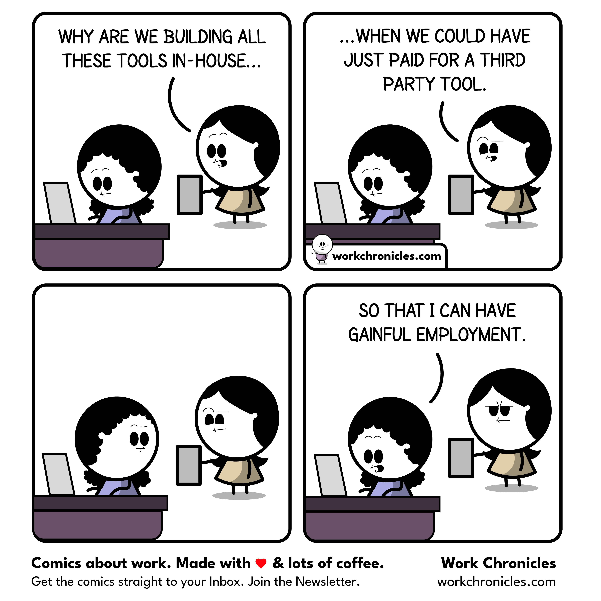

# Jeferson Franco

**Full Stack Engineer** at GFT Technologies, Brazil 
React and TypeScript front ends, Java and Python services, applied AI (LLM, RAG, MCP)

<table>
<tr><td><b>Now</b></td><td>Full Stack Engineer at GFT Technologies, on a performance-reporting project for Cambridge Associates</td></tr>
<tr><td><b>Studying</b></td><td>Postgraduate course in Intelligent Systems and Agents, Federal University of Goiás (2026 to 2027)</td></tr>
<tr><td><b>Certified</b></td><td><a href="https://www.credly.com/badges/cfc4ca3c-88b6-40e3-b25f-7f4f3ff7592b/linked_in_profile">Claude Certified Associate, Foundations</a> (Anthropic) and Wynxx Developer (GFT), both in Nov 2026</td></tr>
<tr><td><b>Writing</b></td><td><a href="https://www.gft.com/br/pt/blog/estrutura-prompts-ia-generativa-times-tecnologia">Estrutura de Prompts para IA Generativa</a>, a guide for technology teams on the GFT blog (Portuguese, Jul 2026)</td></tr>
<tr><td><b>Languages</b></td><td>Portuguese (native), English (full professional), Spanish (professional working)</td></tr>
<tr><td><b>Based in</b></td><td>Brazil, working remotely</td></tr>
</table>

## About

Full Stack Engineer with 6+ years building web apps and APIs. At GFT since July 2025 (Cambridge Associates, investment reporting): React 19 and TypeScript UIs, Java and Spring Boot services, Vermilion reports. Earlier: React and Python dashboards, document-AI services. Strengths: accurate calculations, regression tests, root-cause analysis, AI-assisted engineering (LLM, RAG, MCP).

### Career highlights

- Fixed performance calculations for liquidated private investments (IRR, TVPI, DPI, quartile rank, total value creation) in a Java analytics API. Results now match the legacy report, after stakeholders confirmed the business rules.
- Delivered recommended and non-recommended investment badges across three layers: the React interface, the Java API with DynamoDB persistence and server-side validation, and a Vermilion subtotal report component.
- Raised delivery quality: wrote 42 regression test cases and found root causes of production and UAT defects.
- Applied AI: Claude Certified Associate (Nov 2026), four Anthropic courses, a GFT blog article on prompt structure for generative AI (Jul 2026), and MCP-assisted data analysis in project work.
- Earlier career: React and Python analytics dashboards for global consumer brands (50GB+ daily ETL, 20% better strategic insights) and document-AI services that contributed to a multi-million contract renewal.

<!-- The next block is updated every day by .github/workflows/daily-comics.yml. Keep the image name: latest_workchronicles_comic.png -->
## Latest Work Chronicles Comic

## Experience

### Full Stack Engineer, GFT Technologies

_Jul 2025 to present. Remote, Brazil. Client: Cambridge Associates._

Modernization of private-investment performance reporting. The solution has three connected parts: a React and Java portfolio-setup tool, a Java and Spring Boot analytics API, and report components on the Vermilion reporting platform. The calculation rules replicate the legacy report system, so results must match it.

- Built React 19 and TypeScript features: footnote drag-and-drop, benchmark blend, history-log fixes.
- Built Java and Spring Boot endpoints with DynamoDB persistence and server-side validation.
- Developed Java analytics for liquidated investments: returns, value creation, quartile rank, medians.
- Built Vermilion report components (XML record sets, data sources, entities) with Python tools.
- Wrote requirement and design documents with acceptance criteria and technical impact.
- Wrote 42 regression test cases (API and UI), plus unit tests with Vitest and React Testing Library.
- Found root causes of production and UAT defects. Confirmed business rules with stakeholders.
- Checked result parity between services, reports, and the legacy system (SQL, MCP).

**Stack:** React 19, TypeScript, Vite, Zustand, TanStack Query, AG Grid, dnd-kit, Vitest, React Testing Library, Java, Spring Boot, DynamoDB, SQL Server, Elasticsearch, Vermilion, Python, Bitbucket Pipelines.

### Full Stack Engineer (freelance), NDA clients

_Feb 2025 to Jul 2025. Remote._

- Architected full-stack solutions with React.js, Next.js, and Node.js, and improved performance and scalability.
- Led RAG systems with LLMs for customer support, from data collection and cleaning to preprocessing.
- Designed REST and GraphQL APIs with FastAPI and Flask: OpenAPI schemas, JWT authentication.
- **Project Alpha:** FastAPI microservices on PostgreSQL (SQLAlchemy) and Docker.
- Built Flask CLI tools for data ingestion that cut manual processing time.
- Automated ETL pipelines with Python and Apache Airflow on AWS (S3, RDS, Lambda), with infrastructure as code (AWS CDK).

### Full Stack Developer and Data Engineer, Mtrix

_Apr 2023 to Feb 2025. Remote._

- Built analytics dashboards for global consumer-goods brands. The front end is a React and TypeScript mashup on Qlik Sense: pages built from JSON configuration, separate desktop and mobile trees, i18n in three languages, and ECharts and D3 charts synchronized with Qlik Sense selections.
- Wrote Python ETL jobs (Prefect) that loaded 50GB+ of daily files into a central data warehouse.
- Improved performance with query tuning, smaller Docker images, code splitting, and memoization. The dashboards improved strategic insights by 20%.
- Contributed to the global component library and the micro-frontend architecture.
- Wrote unit and end-to-end tests with Jest and Playwright.

### Full Stack Developer and Functional Analyst, KTGroup Technologies

_Mar 2022 to Apr 2023. Remote._

- Delivered two enterprise web solutions for international clients: Onergy, a process-automation (RPA) platform, and DocsIA, a document-intelligence API that combines OCR with LLM summarization.
- Built the back ends with Node.js and MongoDB, plus Flask and FastAPI services. Celery and Redis queues handle high-volume document processing in DocsIA.
- Built a search and classification engine for the electricity bills of a telecom-tower company, with validation layers for each energy provider's billing rules.
- Contributed to a multi-million contract renewal.
- Moved to Functional Analyst: turned business requirements into technical specifications.
- Took part in architecture decisions and code reviews. Mentored junior developers on API best practices and performance tuning.

<b>Earlier roles, 2019 to 2022</b>

#### Full Stack Developer (freelance)

_Feb 2020 to Mar 2022. Remote._

- Built and maintained web applications with PHP, WordPress, JavaScript, jQuery, SQL, Tailwind CSS, Bootstrap, React.js, Next.js, and Vue.js.
- Moved select internal tools from PHP and WordPress to Python Flask, which improved maintainability and test coverage.
- Worked with ASP.NET MVC on integration and migration projects from WordPress to corporate environments.
- Refactored server-side endpoints and database queries, which improved page load times and SEO rankings.
- Built responsive designs for all devices.

#### Investment Advisor, XP Inc.

_Feb 2019 to Feb 2020. On-site._

- Managed investment portfolios for individual and corporate clients.
- Developed proprietary trading algorithms in Python and MQL5 for high-frequency strategies.
- Prospected new investors and grew the client base.
- Gave personalized advice on financial assets.

## Stack

| Area | Tools |
| --- | --- |
| Front end | **React**, **TypeScript**, **JavaScript (ES6)**, **Next.js**, **HTML5**, **CSS3**, Vite, Zustand, TanStack Query, AG Grid, Vue.js, Bootstrap, jQuery |
| Back end | **Python**, **Node.js**, **REST APIs**, Java, Spring Boot, FastAPI, Flask, GraphQL, Celery and Redis, microservices |
| Data | **SQL**, PostgreSQL, MongoDB, DynamoDB, Elasticsearch, Apache Airflow, Prefect, Qlik Sense |
| Applied AI | **AI-assisted analysis, development, and testing**, LLM, RAG, MCP, prompt engineering, GitHub Copilot, Wynxx |
| Cloud and delivery | **Docker**, AWS (S3, RDS, Lambda, DynamoDB, CDK), CI/CD with Bitbucket Pipelines and GitHub Actions |
| Testing | Vitest, React Testing Library, Jest, Playwright, regression test design |

**Bold** marks the skills I rate highest.

## Projects

| Project | What it does | Tech |
| --- | --- | --- |
| [GeneriClaw](https://github.com/francojeferson/genericlaw) | A personal AI agent that runs on your own machine and answers on Telegram. It takes text, voice, or PDF, reasons in a ReAct loop, runs tools on your file system, and keeps chats in a local database. The LLMs only run inference. | TypeScript, SQLite, local Whisper |
| [JiuPresence](https://github.com/francojeferson/jiu_presence) | An offline-first app for jiu-jitsu class attendance. The goal is a roll call for 20 students in under 90 seconds, with no internet on the mat. Data syncs when the network returns. | TypeScript, PWA, Supabase |
| [Top Tools](https://github.com/francojeferson/top-tools) | Curated developer tools, VS Code extensions, and settings. | Shell, Markdown |
| [Template Mashup HD](https://github.com/francojeferson/template-mashup-hd) | Base template for Qlik Sense mashups: pages built from JSON, i18n in Portuguese, English, and Spanish, responsive layouts. A work sample from the Mtrix period. | React, TypeScript |
| [Onergy](https://github.com/francojeferson/onergy) | JavaScript automation scripts and a REST client for the Onergy process-automation platform. A work sample from the KTGroup period. | JavaScript |

## Certifications

| Credential | Issuer | Date |
| --- | --- | --- |
| [Claude Certified Associate, Foundations](https://www.credly.com/badges/cfc4ca3c-88b6-40e3-b25f-7f4f3ff7592b/linked_in_profile) | Anthropic | Nov 2026 |
| Wynxx Developer | GFT Technologies | Nov 2026 |
| [Claude Academy: Building with the Claude API](https://academy.claude.com/verify/363935134fc26d38ca5dd6d50156b58a) | Anthropic | Oct 2026 |
| [AI Capabilities and Limitations](https://verify.skilljar.com/c/vp2bw8p5xnnq) | Anthropic | Oct 2026 |
| [Introduction to Claude Cowork](https://verify.skilljar.com/c/ir3zzidacsxh) | Anthropic | Oct 2026 |
| [AI Fluency Framework & Foundations](https://verify.skilljar.com/c/42sv6ufndnga) | Anthropic | Sep 2026 |

<b>More: conferences, university courses, English</b>

| Credential | Issuer | Date |
| --- | --- | --- |
| [You Inside Connection](https://acred.it/BYa5H) | GFT Technologies | Oct 2026 |
| [Foundations of Behavioral Science](https://badges.plus.columbia.edu/a79a9452-93e8-4cbd-9d13-c813c733d371) | Columbia+ | Jul 2025 |
| [Learning AI Through Visualization](https://badges.plus.columbia.edu/5cfb984d-ac44-4c38-aca6-03f300f1d7eb) | Columbia+ | Jul 2025 |
| [NLW Agents - Avançado](https://app.rocketseat.com.br/certificates/149ac3a9-8841-4f96-a4b5-06ad9b14d133) | Rocketseat | Jul 2025 |
| [React Summit 2025](https://gitnation.com/person/jeferson_franco_133940/certificates/29967) | GitNation | Jun 2025 |
| [Node Congress 2025](https://gitnation.com/person/jeferson_franco_133940/certificates/27878) | GitNation | Apr 2025 |
| [Conversation-based English](https://www.cambly.com/en/certificate/verify/a52b7fc0) | Cambly | Apr 2025 |
| [Quantitative Techniques](https://badges.plus.columbia.edu/328f3bbb-4879-47bf-aa8e-6fbf4cb7aeae) | Columbia+ | Mar 2025 |
| [EF SET score, B2 upper intermediate](https://www.efset.org/cert/PoZQzo) | EF SET | Jan 2024 |

## Education

- **Postgraduate degree, Intelligent Systems and Agents.** Federal University of Goiás (UFG), Sep 2026 to Dec 2027.
- **Bachelor's degree, Business Administration, emphasis in Foreign Trade.** Paulista University (UNIP), May 2007 to Nov 2011. Coursework: Business Analytics, Process Management, International Trade.

## Contact

---

_"Empowering minds, guarding freedom, and mentoring humility for a more conscious generation."_

